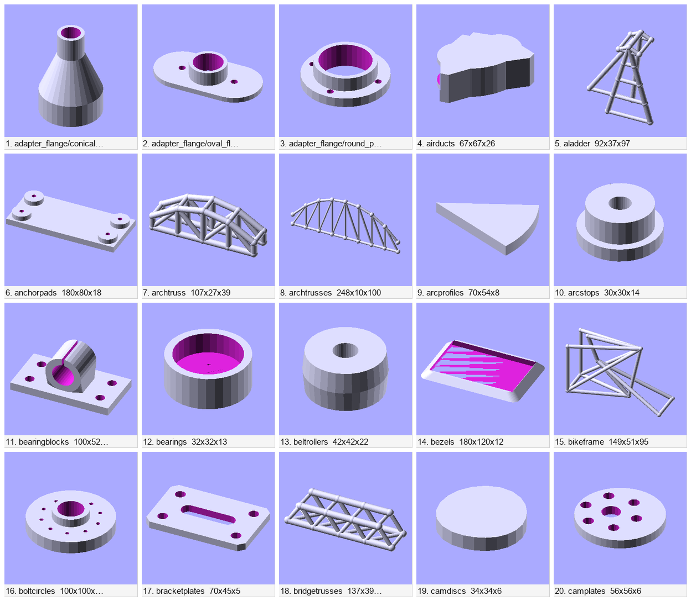
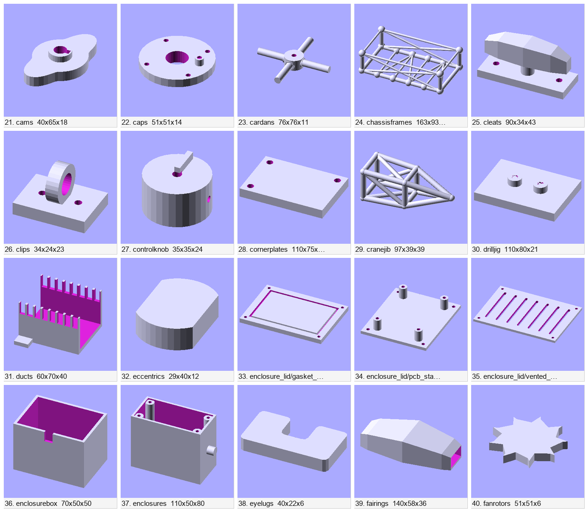
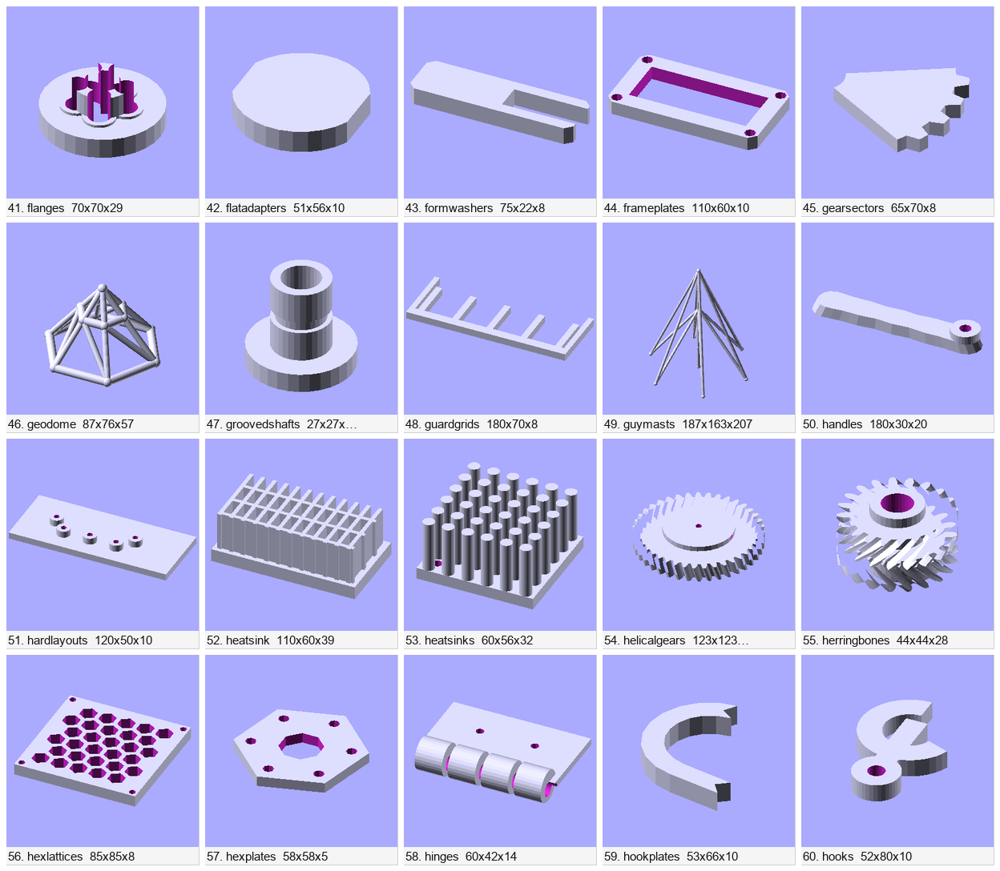
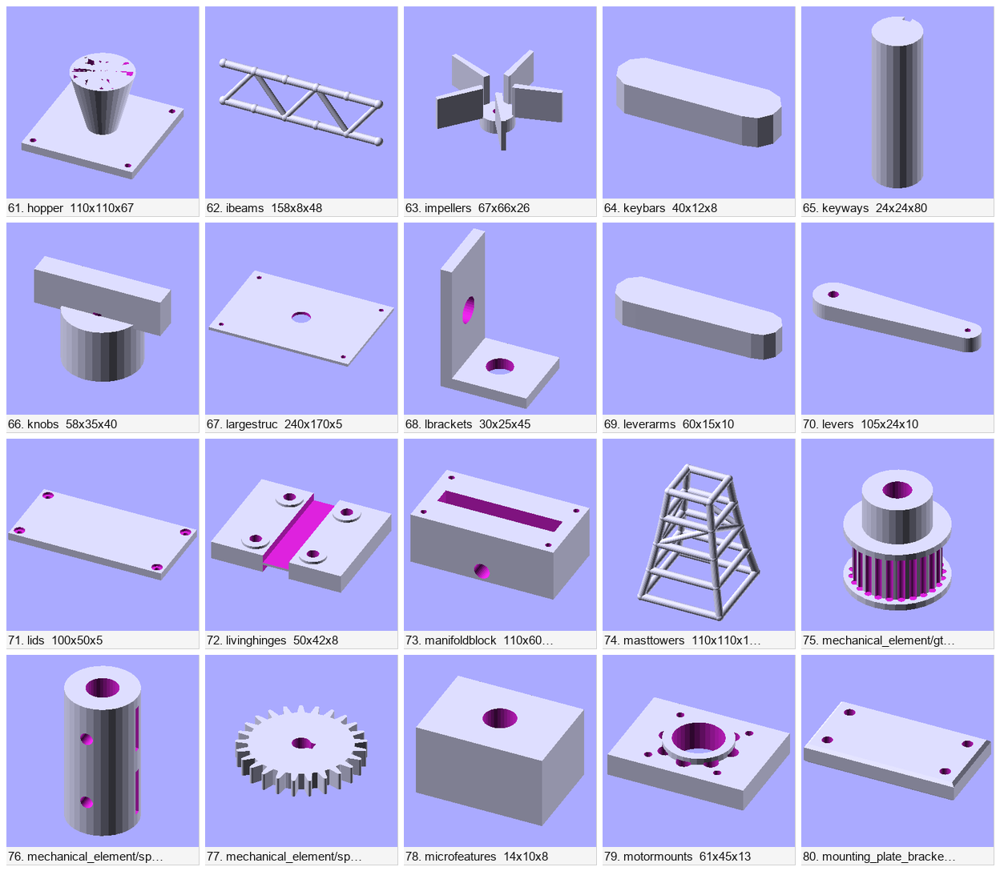
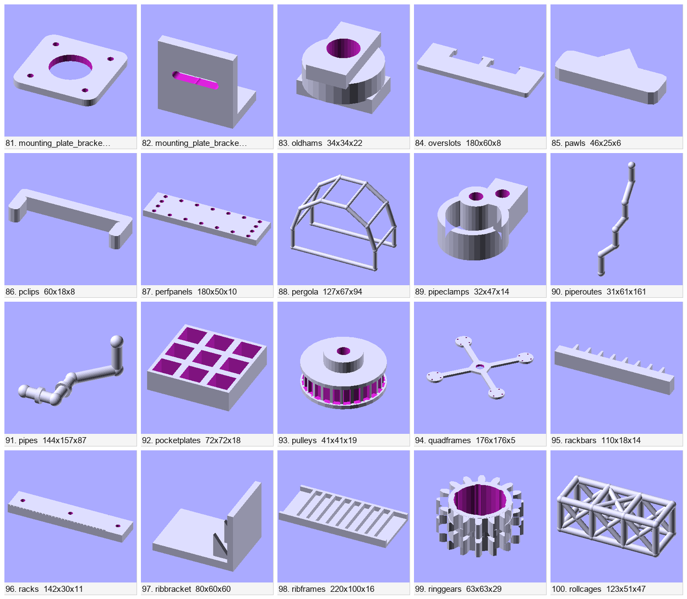
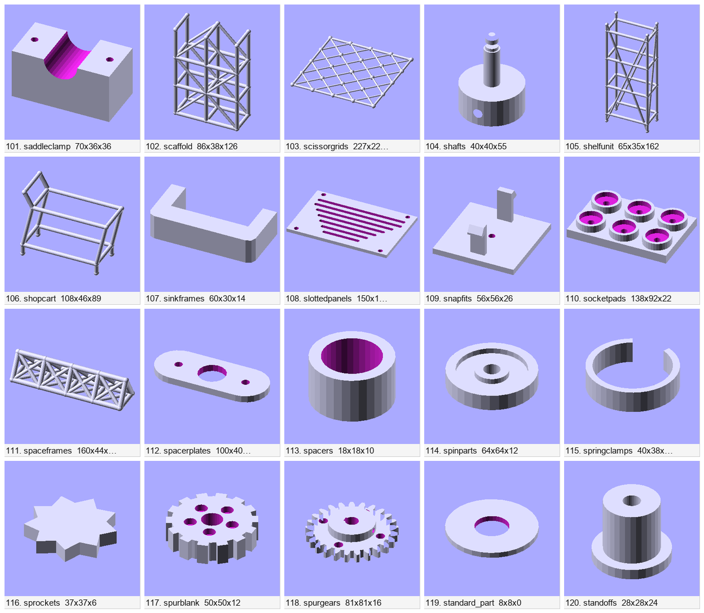
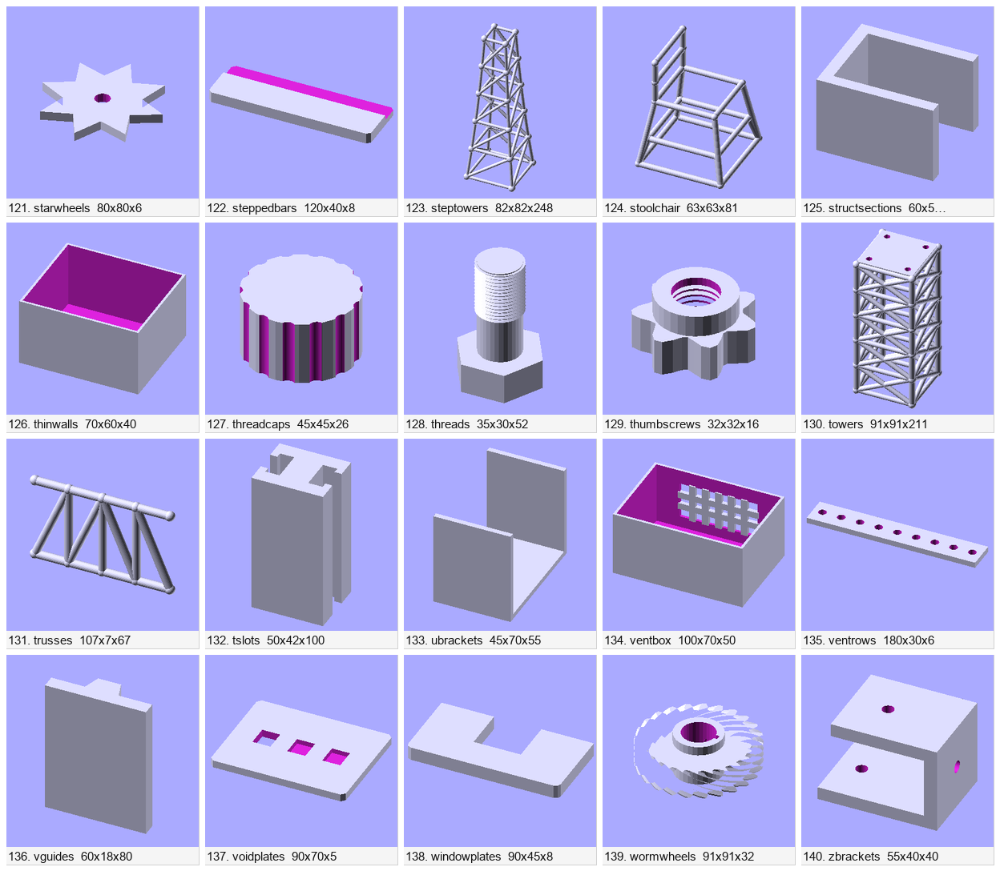

# Превью обучающей выборки по семействам (срез v9)

По одному детерминированному образцу на семейство (`metadata.origin`), 140 семейств.
Изометрия 320×320, ортопроекция. Полные подписи и промпты — [`manifest.md`](manifest.md)
(там же колонка `id` строки корпуса), машинный формат — [`manifest.jsonl`](manifest.jsonl).
Шаблон вердиктов для проверяющего vision-агента — [`verdict_template.csv`](verdict_template.csv)
(заполняется `verdict` = ok/bad; чистка — `tools/filter_corpus_by_verdict.py`).

| | |
|---|---|
|  |  |
|  |  |
|  |  |
|  | |

Листы 1248×1088, плитка 240 px — без даунскейла при просмотре. Полные кадры:
`png/<family>.png` (320×320). Исходники `scad/` в git не коммитятся — при нужде
перегенерировать:
`python tools/render_family_previews.py --input data/processed/combined_v9_fixed.jsonl --out data/previews/families_v9`.

Слои: voxel 80 / wire 25 / sketch 35.
