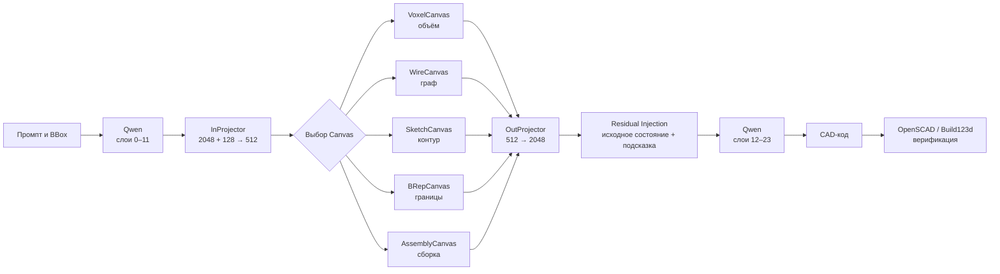

# Как устроены Spatial Canvas в OmniCraft-LM

## Простое объяснение VoxelCanvas, WireCanvas, SketchCanvas и Latent Bridge

OmniCraft-LM объединяет языковую модель Qwen3.5-2B со специализированными пространственными нейросетями — **Spatial Canvas**.

Проще всего представить систему так:

> **Qwen — главный инженер, а Canvas-модули — специализированные инженерные инструменты, подключённые к нему в середине размышления.**

Canvas не заменяют Qwen и не являются отдельными языковыми моделями. Они добавляют к языковому пониманию пространственную информацию о форме, конструкции или взаимном положении деталей.

---

## Являются ли Canvas просто файлами с матрицами?

Файлы:

- `src/model/voxel_canvas.py`;
- `src/model/wire_canvas.py`;
- `src/model/sketch_canvas.py`;
- `src/model/brep_canvas.py`;
- `src/model/assembly_canvas.py` —

содержат Python-классы нейросетевых модулей PyTorch. Эти `.py`-файлы описывают:

- какие операции выполняются;
- какие слои соединены между собой;
- тензоры какой формы модуль принимает и возвращает;
- какие обучаемые параметры необходимо создать.

Сами файлы исходного кода — это **описание вычислений**, а не готовые обученные знания. После обучения параметры Canvas сохраняются отдельно, например:

```text
checkpoints/voxel/canvas.pt
checkpoints/wire/canvas.pt
```

Внутри Qwen и Canvas действительно находятся тензоры и обучаемые матрицы весов. Однако их масштаб и назначение отличаются.

| Qwen3.5-2B | Spatial Canvas |
|---|---|
| Около двух миллиардов параметров | Значительно меньший специализированный модуль |
| Понимает и генерирует язык | Обрабатывает пространственную структуру |
| Основан на Transformer-архитектуре | Использует CNN, GNN или MLP |
| Работает с последовательностью токенов | Работает с объёмом, графом, эскизом или сборкой |
| Универсальная модель | Подключаемый геометрический инструмент |

---

## VoxelCanvas: объёмный мысленный черновик

`VoxelCanvas` похож на небольшую трёхмерную свёрточную нейросеть.

```text
512 чисел
    ↓
объёмная сетка 16 × 16 × 16
    ↓
3D-свёртки и остаточные блоки
    ↓
512 чисел
```

Модель условно размещает деталь внутри куба, разделённого на:

```text
16 × 16 × 16 = 4096 ячеек
```

Для каждой ячейки используется 32 внутренних признака. Это не готовый STL-файл и не буквальная карта заполненности детали, а скрытое нейросетевое представление объёмной формы.

VoxelCanvas предназначен прежде всего для:

- корпусов;
- отверстий и полостей;
- монолитных деталей;
- стенок и оболочек;
- булевых операций `union()` и `difference()`.

---

## WireCanvas: мысленный граф каркаса

`WireCanvas` представляет конструкцию как набор пространственных точек и связей между ними.

```text
512 чисел
    ↓
32 пространственные вершины
    ↓
связи между вершинами
    ↓
графовая нейросеть EdgeConv
    ↓
512 чисел
```

Упрощённо такой граф выглядит следующим образом:

```text
точка A ───── точка B
   │          ╱
   │        ╱
точка C ───── точка D
```

Вместо обработки сплошного объёма WireCanvas анализирует узлы, рёбра и топологию конструкции. Он подходит для:

- ферм;
- рам;
- балок;
- труб;
- пространственных каркасов;
- конструкций из стержней.

---

## SketchCanvas: мысленный двумерный чертёж

`SketchCanvas` похож на небольшую нейросеть обработки изображений, но работает не с фотографией, а со скрытым двумерным представлением контура.

```text
512 чисел
    ↓
двумерные карты признаков
    ↓
2D-свёртки
    ↓
512 чисел
```

Он полезен для геометрии, которую естественно сначала определить на плоскости, а затем превратить в объём:

```text
2D-контур → выдавливание или вращение → 3D-деталь
```

Типичные задачи:

- фланцы;
- профили;
- шестерни;
- замкнутые контуры;
- `linear_extrude()`;
- `rotate_extrude()`.

---

## BRepCanvas: грани, рёбра и вершины

B-Rep означает **Boundary Representation** — представление объекта через его границы:

```text
грани → рёбра → вершины
```

Например, цилиндр можно описать через две плоские круглые грани, одну цилиндрическую поверхность и соединяющие их рёбра.

`BRepCanvas` предназначен для обработки признаков таких геометрических элементов и преобразования их в общий вектор размерности 512.

В текущем состоянии проекта это прежде всего архитектурная точка расширения. Полноценная обработка NURBS, точной B-Rep-топологии и Open CASCADE должна развиваться поверх этого интерфейса.

---

## AssemblyCanvas: взаимное положение деталей

`AssemblyCanvas` описывает не форму одной детали, а структуру сборки:

```text
Корпус
├── Вал
├── Подшипник
└── Крышка
```

На вход он принимает матрицы трансформации `4 × 4`, которые кодируют:

- положение компонента;
- его поворот;
- отношение к другим компонентам сборки.

Например, такое представление должно помогать выразить, что подшипник находится внутри корпуса, вал проходит через подшипник, а крышка установлена сверху.

Текущая реализация кодирует матрицы положения компонентов в общий 512-мерный вектор. Полноценные сопряжения, ограничения и проверка столкновений являются дальнейшим направлением развития.

---

## Почему используются размерности 2048 и 512

Qwen3.5-2B на каждом внутреннем шаге представляет смысл токена вектором из 2048 чисел:

```text
[0.12, -0.48, 0.07, ..., 0.91]
```

Отдельное число обычно не имеет понятного человеку значения. Весь вектор совместно кодирует смысл текста, контекст и намерение модели.

Все Spatial Canvas стандартизированы на меньшую общую размерность:

```text
512 чисел
```

Поэтому между Qwen и Canvas нужны два преобразователя — `InProjector` и `OutProjector`.

---

## InProjector: перевод с внутреннего языка Qwen

Перед запуском Canvas система объединяет:

- скрытое состояние Qwen размерности 2048;
- представление физических габаритов размерности 128.

```text
Qwen: 2048 чисел
+
масштаб детали: 128 чисел
          ↓
     InProjector
          ↓
Canvas: 512 чисел
```

`InProjector` можно воспринимать как переводчика:

> «Вот что Qwen понял из текста. Теперь представь это в виде объёма, графа, эскиза или сборки».

Перед этим размеры детали проходят через `ScaleMLP`:

```text
BBox [100, 50, 20]
          ↓
ScaleMLP: 3 → 64 → 128
          ↓
128 чисел масштаба
```

Это позволяет системе различать две геометрически похожие детали, одна из которых имеет размер 10 мм, а другая — 500 мм.

---

## OutProjector: перевод результата обратно в Qwen

Canvas возвращает вектор из 512 чисел, но Qwen работает с векторами шириной 2048. Поэтому результат нельзя передать обратно напрямую.

`OutProjector` выполняет обратное преобразование:

```text
результат Canvas: 512
          ↓
     OutProjector
          ↓
формат Qwen: 2048
```

Его можно воспринимать как обратного переводчика:

> «Canvas сформировал пространственное представление. Теперь переведём его обратно на внутренний язык Qwen».

Полный путь выглядит так:

```text
Qwen 2048
    ↓ InProjector
Canvas 512
    ↓ OutProjector
Qwen 2048
```

---

## Residual Injection: добавление пространственной подсказки

На 12-м слое имеется исходное скрытое состояние Qwen:

```text
h_mid = понимание текста и контекста
```

После обработки Canvas появляется пространственная подсказка:

```text
h_spatial = результат Canvas после OutProjector
```

Система складывает эти два вектора:

```text
новое состояние = h_mid + h_spatial
```

Это называется **Residual Injection**, или остаточная инжекция.

Canvas не заменяет исходное понимание Qwen, а дополняет его. Упрощённый пример:

```text
Понимание Qwen:
«Нужно написать код корпуса»

             +

Подсказка Canvas:
«У корпуса должны быть объём, стенки и внутренняя полость»

             =

Уточнённое представление:
«Нужно написать код полого корпуса заданного размера»
```

Если полностью заменить скрытое состояние результатом Canvas, модель может потерять сведения о тексте пользователя, синтаксисе OpenSCAD, предыдущих токенах и дополнительных требованиях. Сложение позволяет сохранить исходную информацию.

---

## Почему используется Layer 12

Упрощённо Qwen3.5-2B можно представить как последовательность из 24 слоёв:

```text
Слои 0–11  → понимание входного текста
Layer 12    → подключение Spatial Canvas
Слои 12–23 → использование пространственной подсказки
```

Если подключить Canvas слишком рано, модель ещё не успеет сформировать достаточно содержательное понимание запроса. Если подключить его слишком поздно, оставшимся слоям может не хватить глубины для использования пространственной информации.

Поэтому середина сети выбрана как компромиссная точка:

```text
Текст пользователя
        ↓
Qwen понимает задачу
        ↓
Layer 12: Canvas добавляет геометрическую информацию
        ↓
Qwen превращает объединённое представление в CAD-код
```

Выбор именно 12-го слоя является архитектурной гипотезой и должен подтверждаться сравнительными экспериментами с другими точками инжекции.

---

## Для чего нужен HookManager

`HookManager` подключает Canvas к выбранному слою Qwen без переписывания внутренней реализации языковой модели.

Он запускает Canvas при первичной обработке всего промпта:

```text
seq_len > 1 → этап prefill → Canvas активен
```

При генерации каждого следующего токена Canvas повторно не запускается:

```text
seq_len == 1 → этап decode → скрытое состояние проходит без изменения
```

Без этого ограничения тяжёлый пространственный модуль мог бы запускаться сотни или тысячи раз — по одному разу на каждый новый токен CAD-кода.

```text
Первичное чтение промпта:
Canvas запускается один раз

Авторегрессионная генерация CAD-кода:
Canvas повторно не запускается
```

---

## Полный процесс простыми словами

1. Пользователь описывает требуемую деталь.
2. Qwen читает описание и формирует внутреннее понимание задачи.
3. На 12-м слое Qwen передаёт своё представление в Latent Bridge.
4. `ScaleMLP` кодирует физические размеры детали.
5. `InProjector` преобразует `2048 + 128` признаков в 512 признаков Canvas.
6. Выбранный Canvas обрабатывает объём, граф, эскиз, B-Rep или структуру сборки.
7. `OutProjector` преобразует результат Canvas из 512 обратно в 2048 признаков.
8. Пространственная подсказка складывается с исходным состоянием Qwen.
9. Оставшиеся слои Qwen используют объединённую информацию.
10. Qwen генерирует OpenSCAD- или Build123d-код.
11. CAD-окружение компилирует и проверяет полученную геометрию.

---

## Краткая схема



---

## Главная идея

> **Spatial Canvas не строит окончательную CAD-модель самостоятельно. Он создаёт для Qwen внутреннюю пространственную подсказку, которая должна помочь языковой модели написать более корректный CAD-код.**

Qwen отвечает за понимание задания и генерацию программы. Canvas специализируется на пространственной структуре. `InProjector` и `OutProjector` переводят данные между двумя внутренними форматами, а Residual Injection аккуратно добавляет геометрическую подсказку, не уничтожая исходное языковое представление.
