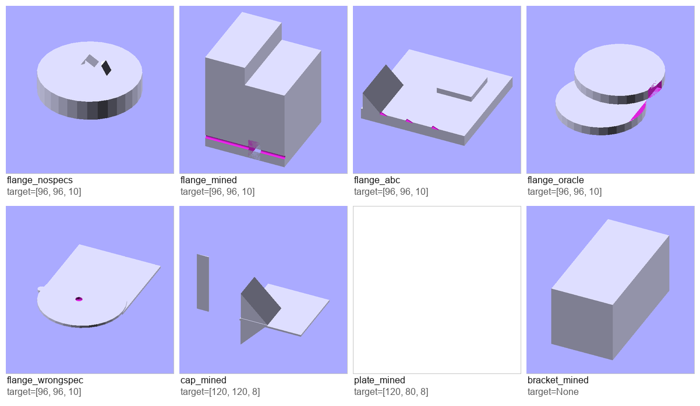
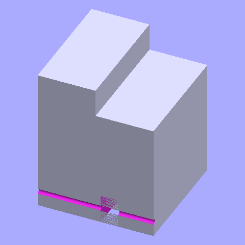
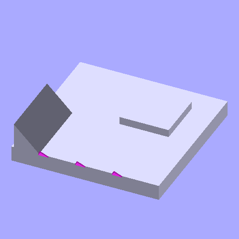
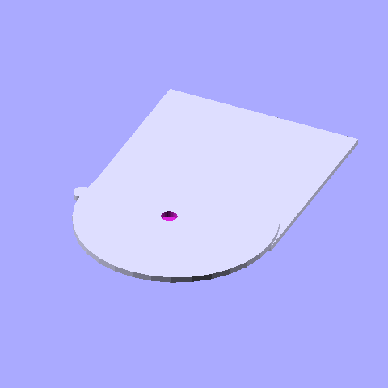
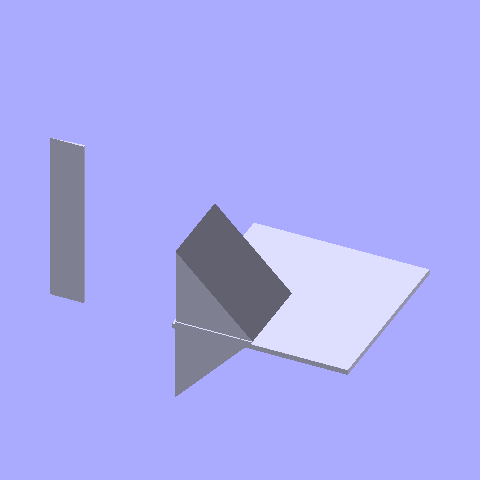
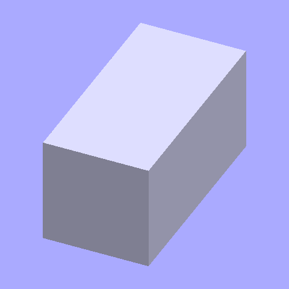

# Доказательная база по `[SPECS]`

Постановка задачи: [`TASK.md`](TASK.md) (копия `docs/SPECS_INVESTIGATION_TASK.md`).
Модель: `checkpoints/voxel` (v9, step 2900, `splits_v9`), greedy, ≤1024 токена.

| случай | режим | class в блоке | block bbox | ожид. | факт. bbox | max отн. ошибка | compile |
|---|---|---|---|---|---|---|---|
| `flange_nospecs` | без `[SPECS]` | — | — | 96,96,10 | 96, 96, 63.3 | 5.33 | да |
| `flange_mined` | текущий рантайм | freeform | 100,100,100 | 96,96,10 | 100,100,124 | 11.4 | да |
| `flange_abc` | габарит `96x96x10` | freeform | 96,96,10 | 96,96,10 | 96,96,26.4 | 1.64 | да |
| `flange_oracle` | правильный блок | flange | 96,96,10 | 96,96,10 | 96,143,21 | 1.1 | да |
| `flange_wrongspec` | неверный блок | flange | 200,200,20 | 96,96,10 | 209,300,10 | 2.125 | да |
| `cap_mined` | второй «диаметр» | freeform | 100,100,100 | 120,120,8 | 169,100.8,142.8 | 16.85 | да |
| `plate_mined` | габарит `AxBxC` | freeform | 120,80,8 | 120,80,8 | — | — | нет (parser) |
| `bracket_mined` | размеров нет | freeform | 100,100,100 | — | 100,198,100 | — | да |

## Картинки по кейсам

### flange_mined — жалоба (куб 100³ из заглушки bbox)

Код: [`flange_mined.scad`](flange_mined.scad)

### flange_nospecs — без блока, масштаб холсту дан верно

Код: [`flange_nospecs.scad`](flange_nospecs.scad)

### flange_abc — верный bbox, но class `freeform`: «freeform cube», не фланец

Код: [`flange_abc.scad`](flange_abc.scad)

### flange_oracle — class `flange`: узнаваемый цилиндрический фланец

Код: [`flange_oracle.scad`](flange_oracle.scad)

### flange_wrongspec — деталь уехала за неверным блоком, а не за текстом

Код: [`flange_wrongspec.scad`](flange_wrongspec.scad)

### cap_mined — второй диаметр-промпт, мусор

Код: [`cap_mined.scad`](cap_mined.scad)

### plate_mined — верный bbox, но parser error (противоречивый topology)
Код: [`plate_mined.scad`](plate_mined.scad) (PNG нет — не скомпилировалось)

### bracket_mined — размеров нет, generic

Код: [`bracket_mined.scad`](bracket_mined.scad)

Полные записи: [`cases.jsonl`](cases.jsonl) · сводка: [`report.md`](report.md)
